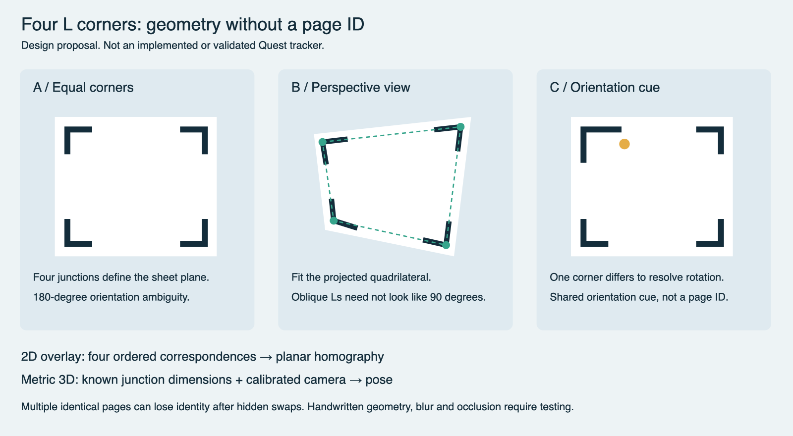

# Four L-shaped corners: track the sheet without content identity

**Feasible design proposal, not a detector or a verified Quest result.** Requested October 9, 2026: ignore what the page contains and estimate the page geometry from four drawn L corners, including oblique views.

Related repository work: [synthetic four-L detector experiment](../../experiments/shape-corner-benchmark/README.md). Its reported generated-frame results are not real-camera or metric-3D validation; the implementation currently rejects hidden corners and multiple sheets. This design note does not promote that detector to physical acceptance.



## What works without an encoded ID

Detect the junction of each printed L, associate four junctions with one planar rectangle, and fit its geometry. The interior can be blank or change freely. A per-session track handle is sufficient to overlay generic content on each currently visible sheet; that handle is not a persistent physical identity.

- **2D perspective registration:** four correctly ordered, nondegenerate corner correspondences determine a planar homography. A tilted page appearing as a trapezoid is expected, not itself a failure. This supports rectifying the camera image and mapping a known 2D overlay onto the sheet.
- **Metric 3D pose:** camera intrinsics/distortion calibration plus the actual physical width/height of the junction rectangle permit a calibrated planar pose solve. Use reprojection error, positive depth, temporal consistency and appropriate planar-pose ambiguity handling. Four corners alone do not provide a known scale in meters.
- **Headset AR:** transform the pose using camera-to-headset calibration and headset pose at image capture time, then render correctly for both eyes. A camera-image homography alone is not sufficient for binocular world-anchored content.

The dimensions are **between L junctions**, not necessarily the outer paper edge. A screen-displayed test target must have the same measured physical junction dimensions used by the pose solver; changing window zoom changes physical scale.

## Symmetric versus oriented design

1. **Four equal inward L corners:** simplest to draw. The set supports a rectangle, but its appearance is invariant under a 180-degree rotation (90 degrees for a square). Temporal continuity can temporarily choose an orientation; first acquisition or reacquisition cannot infer an unmarked semantic top.
2. **One distinct corner:** give one L a reliably different arm ratio or an extra adjacent mark. This encodes a shared orientation cue, **not a unique per-page ID**. Detection needs to account for perspective foreshortening instead of comparing raw pixel lengths naively.
3. **Printed template for the first test:** consistent junction placement and bold dark strokes simplify calibration. Only then assess freehand drawing tolerance. If handwritten junction locations differ from the assumed rectangle, a rigid rectangular fit may become biased; use measured anchors or reject excessive geometric residuals.

## Detector design

```text
Frame and timestamp
  → contrast/edge extraction
  → pairs of line segments with a shared L junction
  → candidate junctions and arm directions
  → plausible four-corner sheet groups
  → robust planar geometric fit + reprojection checks
  → per-session association + tracked/lost state
  → homography or calibrated pose + uncertainty
```

An oblique L is not necessarily a right angle in the captured image. Do not require image-space 90-degree arms. Use the joint quadrilateral geometry, line directions and visibility to reject unrelated text, window edges and table corners. Apply calibrated distortion correction before precise pose estimation.

Multiple sheets require grouping: four visible Ls do not automatically tell us which sheet they belong to. Validate a coherent rectangle with inward arm directions and use previous observations where justified. Rapid motion, nearby/overlapping sheets and similar page sizes can make several groupings plausible; report uncertainty rather than selecting arbitrarily.

## Limits that matter

- A hidden junction reduces directly available corner correspondences. Three junctions by themselves do not determine an unrestricted homography; additional visible arm/edge constraints, known geometry or bounded temporal prediction may help but need separate validation.
- Repeated identical sheets can be tracked continuously, but swapping them under occlusion destroys guaranteed persistent identity. Contents cannot be recovered from geometry alone.
- Very oblique views compress arm features; blur, glare, faint pencil and small marks may make them undetectable. Set minimum image-space size and confidence criteria from tests.
- Flexible/curved paper is not one rigid plane. A single pose or homography cannot exactly align every part of a bent sheet.
- A planar pose can be unstable near weak-perspective views or poorly resolved corners. Continuity is a cue, not ground truth; evaluate against an independently measured reference.

## Proposed first experiment

Use one flat sheet with four bold inward Ls, known junction-to-junction width/height, and a calibration cube plus planar grid in AR. Compare symmetric Ls with one oriented variant. Test front/oblique view, motion, 180-degree rotation, hand coverage and reacquisition. Then expand to three sheets, overlap and hidden swaps. Separate paper and monitor trials.

Record ID-free geometry success, false sheet groups, corner-order changes, reprojection error, reference-measured pose/alignment error, jitter, loss and reacquisition time. Show whether each result is directly observed or predicted. No numerical reliability result is claimed here.

This is a strong low-visual-complexity baseline for **page geometry first, content identity later**. Add unique identity only when persistent per-sheet behavior is actually needed. It does not replace the existing rendering repair or prove an implemented L-corner tracker.

Production: deterministic SVG and Quick Look PNG; diagram inspected for four corners, asymmetric cue, perspective example and caveats. Existing 20-concept sheet remains unchanged. [Editable diagram](l-corners.svg).
