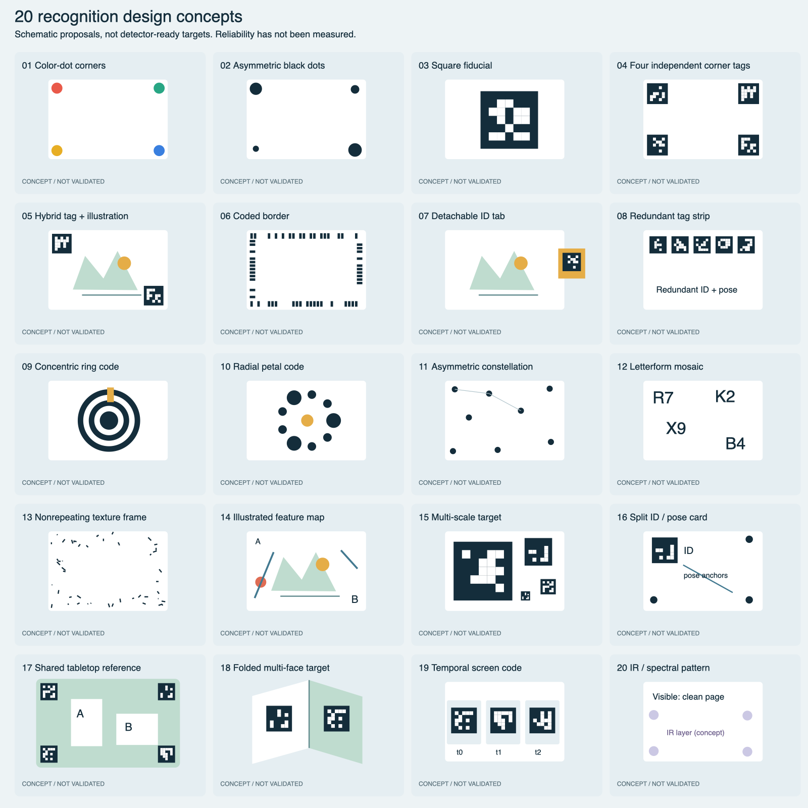

# Recognition patterns and dynamic paper content

**Design proposals, not demonstrated tracking results.** This package separates two questions: what the camera recognizes, and what the paper displays in AR. The 20 sketches are not encoded ArUco/AprilTag targets or calibrated test sheets. They include established marker families, layout variants, and speculative sensing concepts; they are not 20 implemented detectors.



[Editable overview](recognition-patterns-20.svg) · [Reproducible sketch generator](generate.py) · [Display content ideas](DISPLAY-CONTENT.md)

**Follow-up: [four L-shaped corners without a page ID](L-CORNERS.md)** — illustrated geometry-first design, oblique-view homography, calibrated 3D pose, and multi-sheet ambiguity.

## Recommendation

Start with a **Dynamicland-inspired separation of physical identity, spatial pose, and programmable behavior**, rather than making each content image the sole identity. This is an architectural recommendation, not a claim that colored dots are the most reliable Quest detector, or a copy of official Realtalk. Dynamicland is a communal spatial computing medium, not just a marker design.

For Quest, compare three practical candidates first:

1. **04 / independently coded corners:** each corner has a unique dictionary ID; a board map associates corner IDs with one sheet and their physical transforms. Multiple visible tags can cross-check sheet pose. A single calibrated tag may still yield pose, but reduced observability must be reflected in confidence. Tiny tags can be worse at distance; test scale rather than assuming more tags always help.
2. **05 / hybrid tag + natural illustration:** tags establish explicit identity while an authored high-feature illustration supplies additional image tracking. Fuse only when both estimates agree in one coordinate convention. Useful when the marker disappears behind a hand.
3. **07 / detachable ID tab:** keep lesson art unmodified and move identity into a tab with a known rigid transform. This is easy to swap, but attachment slippage invalidates pose calibration.

Keep **01 / colored dots** as the existing baseline and **03 / one standard square tag** as the low-complexity baseline. A fixed overhead camera/projector installation and a moving headset have different illumination, viewing angle, occlusion, latency, and calibration constraints. Test them separately.

For a first demo, favor 04 with validated dictionary-generated tags, fixed physical dimensions and only three simultaneous sheets. Do not invent a new detector before a standard baseline works.

## Twenty alternatives

| # | Design | Recognition / identity mechanism | Useful property to test | Main limitation / work needed |
|---|---|---|---|---|
| 01 | [Color-dot corners](01-color-dot-corners.svg) | Corner color sequence + known sheet geometry | Visually friendly; existing baseline | Lighting/color shift; corner association across many sheets; limited codes |
| 02 | [Asymmetric black dots](02-asymmetric-black-dots.svg) | Dot sizes and asymmetric layout | Avoids dependence on hue | Perspective changes apparent size; custom codebook and pose disambiguation |
| 03 | [Square fiducial](03-square-fiducial.svg) | Standard ArUco or AprilTag dictionary ID | Explicit identity and known-size pose | One hand can hide the entire tag; distance/size limit; drawing is schematic |
| 04 | [Four independent corner tags](04-four-independent-corner-tags.svg) | Unique tag IDs mapped to one rigid board | Redundancy, sheet disambiguation, partial occlusion | Needs board geometry; tags need sufficient pixels; print area cost |
| 05 | [Hybrid tag + illustration](05-hybrid-tag-illustration.svg) | Fiducial ID + image-feature matches | Reacquisition plus rich central content | Coordinate/time-consistent fusion; featureless illustrations still fail |
| 06 | [Coded border](06-coded-border.svg) | Nonperiodic boundary code | Keeps the center free; distributed evidence | Custom decoder, border blur and occlusion; no robustness guarantee |
| 07 | [Detachable ID tab](07-detachable-id-tab.svg) | Tagged clip/tab with calibrated sheet transform | Reusable identity, ordinary documents | Attachment can move; small tab and occlusion; duplicate tab handling |
| 08 | [Redundant tag strip](08-redundant-tag-strip.svg) | Several independent tags along one edge | Some tags survive partial coverage | Collinear layout/oblique viewing; edge can be hidden in one gesture |
| 09 | [Concentric ring code](09-concentric-ring-code.svg) | Ring transitions + orientation key | Rounded visual language | Plain concentric circles cannot resolve rotation; custom robust coding needed |
| 10 | [Radial petal code](10-radial-petal-code.svg) | Nonuniform radial size/occupancy code | Decorative identity with orientation cues | Perspective distorts circular layout; custom detection/code distance |
| 11 | [Asymmetric constellation](11-asymmetric-constellation.svg) | Stored point constellation | Sparse unobtrusive marks | Cross-sheet point grouping, enough correspondences, combinatorial search |
| 12 | [Letterform mosaic](12-letterform-mosaic.svg) | OCR identity + feature/geometry tracking | Human-readable IDs | OCR alone is not calibrated 6DoF pose; blur and rotation |
| 13 | [Nonrepeating texture frame](13-nonrepeating-texture-frame.svg) | Rich unique border features | Center remains editable; image-target route | Needs larger features and descriptor validation; frame-only occlusion |
| 14 | [Illustrated feature map](14-illustrated-feature-map.svg) | Purpose-authored asymmetric natural image | Marker appearance becomes part of artwork | Every target requires image registration; repetition/symmetry degrade identity |
| 15 | [Multi-scale target](15-multi-scale-target.svg) | Large + small known tags in one board map | Wider useful distance range | Minimum visible resolution; cross-scale consistency; small tags can alias |
| 16 | [Split ID / pose card](16-split-id-pose-card.svg) | One ID region + distributed geometric anchors | Separate decoding from plane estimation | Occluded ID needs bounded caching; anonymous anchors can be misassociated |
| 17 | [Shared tabletop reference](17-shared-tabletop-reference.svg) | Table mat establishes world frame; sheets still need identity/motion sensing | Stable common reference across objects | Mat alone cannot identify or track freely moving blank sheets |
| 18 | [Folded multi-face target](18-folded-multi-face-target.svg) | Calibrated tags on rigid noncoplanar faces | Some face visible over wider angles | Not flat paper; hinges/flexible folds invalidate rigid model |
| 19 | [Temporal screen code](19-temporal-screen-code.svg) | Time-varying ID frames plus static pose anchors | Dynamic reassignment on displays | Not printable; refresh/rolling-shutter/sync latency; keep pose stable across code changes |
| 20 | [IR / spectral pattern](20-ir-spectral-pattern.svg) | Spectrally separated ink + matching sensor/illumination | Potentially clean visible page | Research hardware path, not a supported Quest RGB-only assumption; sensor/ink proof needed |

## Dynamic system architecture

```text
Camera frame + capture timestamp + calibrated intrinsics
  → target detection / identity / corners
  → rigid sheet pose at capture time
  → headset pose at the SAME capture time
  → world-space sheet pose + confidence + age
  → registry: sheet ID → content ID → behavior + parameters
  → stereo-safe rendering + interactions
```

**Recognition success is not rendering success.** An ID label can work while shaders fail. Correct camera-space pose is not proof of correct binocular world alignment. The pink material failure belongs to rendering; a new target pattern will not fix it.

Keep detection independent of content. Replacing a volcano with a molecule should update a registry entry, not require generating another image target. Register reference images ahead of time when using a natural-image engine; runtime target creation is an engine-specific capability, not a universal promise.

### Object lifecycle and reliability

- A physical sheet ID is unique even when several sheets show the same content. Define behavior for duplicate printed IDs rather than merging their poses accidentally.
- Each observation carries detector family, sheet ID, confidence, camera timestamp, pose timestamp, physical size and coordinate convention. Reject impossible geometry and inconsistent timestamps.
- Fuse observations only when identity, geometry and capture-time transforms agree. Do not average incompatible coordinate spaces.
- Distinguish **detected**, **tracked**, **temporarily lost**, **reacquiring**, and **invalid**. Brief prediction may support continuity, but show its state and expire it; never continue a confident-looking stale moving object indefinitely.
- Use one world-frame convention across Vuforia and marker lanes. Test units, handedness, camera-to-headset extrinsics, image orientation, and left/right eye rendering separately.
- Separate image-target detection from headset tracking validity. Do not render anchored objects from invalid headset pose.
- Explicit IDs reduce identity ambiguity; they do not eliminate camera bandwidth or per-frame detection cost. Measure target-count scaling and engine simultaneous-target limits.
- In a projector setup, evaluate marker changes caused by projected light separately. In Quest AR, virtual rendering does not physically illuminate the page.

## Acceptance experiment, not invented scores

Run 01, 03, 04, 05 and 07 with identical physical sheet size and comparable total marker footprint. Use three content demos from [DISPLAY-CONTENT.md](DISPLAY-CONTENT.md). Log device, app/build, camera mode, target dimensions, illumination and timestamps. Test paper first; test monitor glare/pixel patterns independently.

Include 1 / 3 / 6 / 10 targets; front and oblique views; near/mid/far range; bright/dim conditions; hand occlusion; moving, overlapping and swapping sheets; duplicate IDs; target removal/reappearance; sleep/wake; invalid headset tracking.

Measure correct-ID rate, false positives, identity swaps, acquisition/reacquisition delay, loss duration, static jitter, metric alignment error against an independently measured reference, frame time, and sustained device load. Record stereo video plus logs; label capture limitations. A screen recording without visible passthrough or an independently measured reference cannot certify paper alignment.

Set acceptance thresholds before collecting data, based on intended use. There are **no measured reliability rankings** in this design package. Only promote a candidate after multi-sheet, motion and occlusion trials pass on the actual device.

## Sources and production record

- [Dynamicland](https://dynamicland.org/): primary overview of the spatial communal medium, accessed October 9, 2026. No claim that these sketches implement official Realtalk.
- [AprilTag project](https://april.eecs.umich.edu/software/apriltag): established fiducial family; not benchmarked in this package.
- [OpenCV ArUco documentation](https://docs.opencv.org/4.x/d5/dae/tutorial_aruco_detection.html): reference detector/dictionary route; automated page retrieval was blocked, so no newly fetched benchmark evidence is attributed to it.
- [Vuforia target-design reference](https://developer.vuforia.com/library/vuforia-engine/images-and-objects/image-targets/best-practices-designing-and-developing-image-based-targets/): portal returned only a client-shell page during this task; no hidden portal contents or numerical ratings are claimed.

Authoring: deterministic Python/SVG, no generated implementation screenshots. Every SVG was structurally parsed; all 20 panels were visually inspected on the full-size Quick Look-rendered PNG contact sheet. Text, count, complete panel bounds and concept status were checked. The PNG is a design preview, not a recorded experiment. Reproduce SVGs with `python3 generate.py`; on macOS render the overview with `qlmanage -t -s 1600 -o <temporary-directory> recognition-patterns-20.svg`.

Publication owner: parent design lane; authoritative destination: `origin/main`, `design/recognition-patterns/`. Existing runtime files remain outside this lane. Local production used `/tmp/openclaw` because the external Storage free-space guard failed; no external Storage paths were accessed and no disk cleanup was performed. GitHub is the retained source/preview destination.
