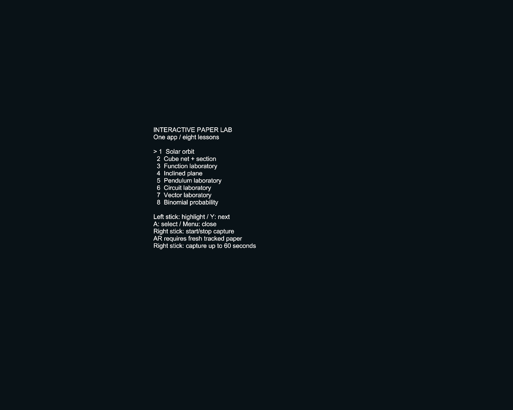

# One Quest app, eight selectable lessons — v14

Ryo clarified that the demonstrations must live in **one Quest app**, selected through a menu rather than separate APKs. Interactive Paper Lab v14 (`org.openclaw.markertrackinglab`, `0.14-teaching-menu`, versionCode14) meets that source/build requirement.

## Menu

The same APK contains Solar, Geometry, FunctionGraph, InclinedPlane, Pendulum, Circuit, Vectors and Binomial. It opens an eight-item head-relative menu before waiting for camera readiness. Left controller Menu opens/closes it; left stick up/down or Y highlights; A selects. Outside the menu, existing A/B/Y controls remain unchanged. Right stick toggles native capture in the same app.

Menu selection invalidates stale/in-flight marker observations, hides the paper content and resets its state. It does not bypass camera/session reliability or invent a paper anchor. The menu is UI; actual lesson animation/interaction still requires a fresh reliable tracked target. The separate Spatial Capture app is not used for switching lessons.

## Verified

- Full pinned Unity Android IL2CPP ARM64 build and APK signature/package metadata.
- Independent read of actual APK developer-agent settings: disabled, empty address/token.
- Safe device update with `adb install -r`; fresh package readback **code14 / 0.14-teaching-menu**. User data, separate apps and continuous-awake worker retained.
- Actual `TeachingMenu` rendered in Unity and visually inspected; 16 navigation-wrap checks passed. This is **editor-only**, not physical controller acceptance.
- Existing 284 model mathematics and 42 camera/timestamp/pose checks rerun. Capture/replay source and viewer checks from v13 retained; no new claim of a physical take.
- Lecture's control slide updated to show the one-app menu.

APK SHA-256: `8c3ea9251916755ef9311b199d694dfde5029777fc6af4d934db8a5999854523`.

[Download v14](https://github.com/ryosuzuki/image-tracking/releases/tag/teaching-menu-v14-2026-10-12) · [Student guide](../tools/teaching-capture/README.md) · [Replay viewer](capture-viewer/) · [Lecture](https://docs.google.com/presentation/d/1-Uv_qqImctIzZ2j2qQ-B5Tv8L6B-dFP48GfJeJqr548/edit)

## Unresolved physical gate

The connected headset lost positional tracking. The OS refused to run this MR app without 6DoF even after a normal diagnostic continuation. Installation is verified; a live headset menu/controller test, native take and paper-locked binocular lesson remain unverified. No Guardian disable, travel-mode enable or synthetic SLAM was used.

## Integration ownership

Completion owner: this lecture/student-kit task. Authoritative target: `origin/main`; exact v14 source changes and docs are integrated there with a fresh readback validator. The canonical external checkout became read-only during this continuation and remains at v13. A separate integration checkout preserves the task-owned v14 work; canonical synchronization awaits external-volume recovery. No remount/repair or unrelated edits were attempted. Four unrelated thin-line-ID files in the canonical checkout remain untouched.
